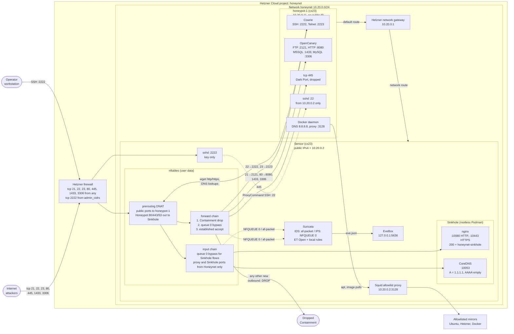

# Honeynet

The Honeynet attracts real attacks so that Suricata can inspect hostile traffic. It is hostile by design. It shares no network, Hetzner project, token or SSH key with other environments. For the terms, see [CONTEXT.md](./CONTEXT.md).

## Architecture



## Hosts

| Host | Address | Runs |
|---|---|---|
| Sensor | Public IPv4, `10.20.0.2` | nftables, Suricata, EveBox, Squid, Sinkhole (nginx, CoreDNS) |
| `honeypot-1` | `10.20.0.11`, no public IP | Cowrie, OpenCanary, in Docker |

Every packet between the internet and a Honeypot goes through the Sensor. The Honeypot default route goes to the Hetzner network gateway. The network route sends it to the Sensor.

## Traffic

| Flow | Path | Result |
|---|---|---|
| Attack on a honeypot port | Sensor DNAT, then forward chain | Cowrie or OpenCanary answers. Port 445 times out. |
| New Honeypot connection to the internet | Forward chain, rule 1 | Dropped (Containment). |
| Honeypot HTTP, HTTPS or DNS to the internet | Sensor DNAT to the Sinkhole | The Sinkhole answers. Nothing leaves the Honeynet. |
| Honeypot apt and image pulls | Squid on `10.20.0.2:3128` | Allowlisted domains only. |
| Operator SSH | Sensor `:2222`, then ProxyCommand to Honeypot `:22` | Key only, from `admin_cidrs`. |

Suricata sees all forwarded and Sinkhole flows. In IPS mode, `bypass` makes the Sensor fail open when Suricata does not read the queue. Containment does not depend on Suricata.

## Ports

| Public port | Honeypot port | Service |
|---|---|---|
| 22 | 2222 | Cowrie SSH |
| 23 | 2223 | Cowrie Telnet |
| 21 | 2121 | OpenCanary FTP |
| 80 | 8080 | OpenCanary HTTP |
| 1433 | 1433 | OpenCanary MSSQL |
| 3306 | 3306 | OpenCanary MySQL |
| 445 | 445 | Dark Port, no service |

## Provisioning

Do the [prerequisites](../../../README.md#prerequisites) first. The Honeynet keeps its state in the bucket that `live/hetzner/ovpn/bootstrap` creates.

1. Create a key pair for the Honeynet only, at `~/.ssh/honeynet`. Do not use a key that is trusted elsewhere.
2. Set `admin_cidrs` in `sensor/terraform.tfvars`. This file is not in Git.
3. Apply `bootstrap` once. It creates the Hetzner SSH key and keeps its state locally:

   ```sh
   make init-bootstrap apply-bootstrap
   ```

4. Provision and configure:

   ```sh
   make init
   make apply      # network, sensor, honeypots
   make configure  # writes the inventory, runs site.yml
   make verify     # runs verify.yml
   ```

`make destroy` removes the roots in the reverse order. It does not remove `bootstrap`.

## Operation

- **EveBox.** Open an SSH local forward, then go to `http://localhost:5636`:

  ```sh
  ssh -i ~/.ssh/honeynet -p 2222 -L 5636:127.0.0.1:5636 admin@<sensor_public_ipv4>
  ```

- **IDS or IPS.** Set `suricata_mode` in `ansible/playbooks/group_vars/all.yml`, then run `make configure`. nftables does not change.
- **Rule updates.** A systemd timer runs `suricata-update` daily for ET Open.

## Rules

- User data owns sysctl and nftables on all hosts. Ansible only checks them.
- A change to the honeypot ports, the DNAT or the nftables rules replaces the Sensor. Run `make configure` again after the replacement.
- To add a honeypot port, add it to `honeypot_tcp_ports` in the Sensor root. If the port is below 1024, also map it in `TF_VAR_honeypot_port_redirects` in the Makefile.
- Do not open Containment. Send new outbound protocols to the Sinkhole.
- The Honeynet collects no malware samples.

## Decisions

- [ADR-0013](../../../docs/adr/0013-suricata-runs-on-an-inline-sensor-that-enforces-containment.md): inline Sensor and Containment
- [ADR-0014](../../../docs/adr/0014-a-static-queue-bypass-rule-keeps-the-sensor-network-in-user-data.md): static `queue bypass` rule
- [ADR-0015](../../../docs/adr/0015-opencanary-replaces-dionaea-and-port-445-becomes-a-dark-port.md): OpenCanary and the Dark Port
- [ADR-0016](../../../docs/adr/0016-the-sinkhole-runs-in-rootless-podman-on-the-sensor.md): the Sinkhole
